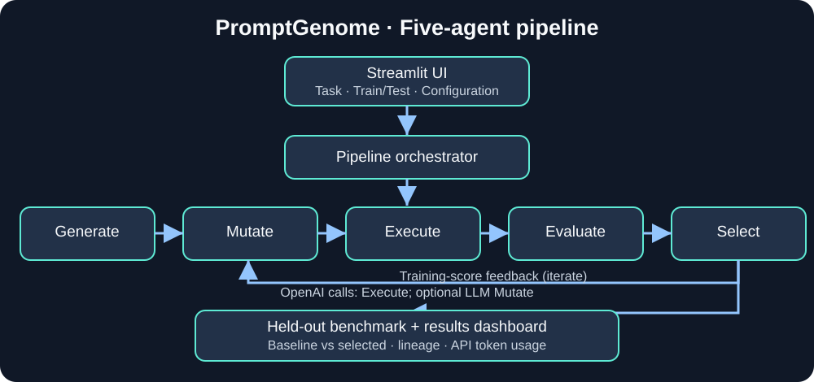

# 🧬 PromptGenome

**PromptGenome** is a five-stage, testable prompt optimization pipeline with a Streamlit interface and OpenAI model adapter. It creates a baseline instruction, generates variants, executes candidates on labeled **training** examples, selects the best training candidate, then evaluates the baseline and selected prompts on **held-out** cases.



See the [architecture and engineering decisions](docs/ARCHITECTURE.md) for component boundaries, evaluation flow, and limitations. The Streamlit UI also includes an expandable architecture view.

## Live demo

[PromptGenome on Streamlit](https://promptgenome.streamlit.app/) — **restricted access**: authorized email addresses only. Ask the project owner for access.

## What it demonstrates

- **Generate:** Build a baseline instruction.
- **Mutate:** Propose deterministic or LLM-generated prompt variants.
- **Execute:** Call OpenAI Chat Completions with candidate instructions.
- **Evaluate:** Score labeled training examples using exact, normalized, JSON-structural, or character-similarity metrics.
- **Select:** Retain a new candidate only if its **training** score strictly improves; record its lineage.
- **Benchmark:** Compare baseline and selected candidates on held-out inputs, with no test-score feedback to selection.
- **Observe:** Show a Streamlit dashboard with accuracy, candidate lineage, token usage, and JSON export.

These are **composable Python agent components**, not autonomous agents or Google ADK agents.

## Demo and measured results

Follow the [UI demo walkthrough](docs/DEMO.md) to run both presets and capture real portfolio screenshots. The [benchmark results template](docs/RESULTS.md) intentionally leaves unmeasured fields blank. **Do not present synthetic or hypothetical improvements as measured results.**

## Reproducible benchmark

The repository includes a synthetic **48-case support-ticket classification benchmark** (36 training, 12 held-out) with four labels. The dataset uses overlapping message templates across splits; it is a functional evaluation, not an independent real-world generalization test. See [benchmark methodology](benchmarks/README.md).

Run a **live, billable** experiment:

```bash
python -m benchmarks.run_support_tickets --model gpt-4o-mini --generations 2 --variants 3 --mutation llm
```

The runner writes `support_tickets_result.json` containing the exact prompts, scores, lineage, settings, and token counts. **No measured benchmark improvement is claimed yet**; the existing uppercase smoke test scored 100% baseline and 100% optimized on two held-out cases. A 0 pp change is expected when the baseline is already perfect. Results may vary between runs.

For stronger claims: repeat experiments, report variation, and evaluate against an independently authored holdout with different templates and edge cases. Never select prompts based on test scores.

## Quick start

Python **3.12** recommended (also used in the Streamlit deployment).

```bash
python -m venv .venv
source .venv/bin/activate
pip install -r requirements.txt
python -m unittest discover -s tests -v
python -m examples.run_pipeline
```

On Windows: `.venv\Scripts\activate`.

Copy `.env.example` to `.env`, set `OPENAI_API_KEY`, then:

```bash
streamlit run streamlit_app.py
```

Use the **Benchmark preset** dropdown to load the 48-case support-ticket benchmark or the small uppercase smoke test automatically. The preset populates the task, training and held-out JSON, and metric. You may edit any inputs before running. Start with 1 generation, 1 variant and deterministic mutation; the UI estimates the maximum billable calls before execution. For the full benchmark, select LLM-generated mutation and adjust the search settings after reviewing the call estimate. Export the result as JSON. Supply separate non-overlapping JSON training and held-out examples with string `input` and `expected` fields.

## Testing and deployment

GitHub Actions runs compilation, offline unit tests, and an offline pipeline smoke test on push/PR. It does **not** run paid API evaluations or browser integration tests. Streamlit Community Cloud deploys the configured GitHub branch automatically; the current demo uses `feature/optimization-pipeline`. Add `OPENAI_API_KEY = "..." ` in Streamlit App settings → Secrets, not in source code.

## Security, cost and limitations

- The live app uses Streamlit's **email allowlist** for access control; do not assume a private GitHub repository or API key alone protects the app.
- OpenAI API calls are billable. Keep API usage budgets/alerts enabled and restrict demo access.
- The model may respond nondeterministically; fixed data and settings do not guarantee identical results.
- Exact/normalized/JSON/character similarity scores are **not semantic correctness** measures.
- Mutation may change task semantics. Human review is necessary before production use.
- Synthetic benchmark cases do not establish real-world performance.
- Results are kept in Streamlit session state and exportable as JSON; there is no persistent experiment database.

## Roadmap

Independent real-world benchmark, repeated-run statistical summaries, semantic evaluation, prompt versioning, and explicit API-call budget enforcement.
