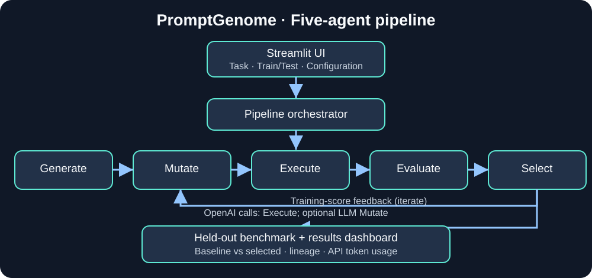

# Architecture and engineering decisions

## Components and data flow

1. **Streamlit UI** (`streamlit_app.py`) loads a preset or accepts task instructions and labeled JSON training/test cases.
2. **GeneratorAgent** produces a baseline prompt from the task.
3. **MutationAgent** proposes deterministic suffix-based variants or calls the OpenAI model to generate prompt alternatives.
4. **ExecutionAgent** sends a candidate prompt and each training input to the configured OpenAI Chat Completions model.
5. **EvaluationAgent** scores responses against training labels using one of four metrics: exact, normalized, JSON structural equality, or character-level similarity.
6. **SelectionAgent** accepts a new candidate only when its **training** score strictly exceeds the incumbent. Otherwise optimization stops.
7. **Held-out benchmark** evaluates baseline and selected prompts on different inputs *after selection*. Results cannot change the winner.
8. **Dashboard** shows baseline/selected held-out scores, training history, lineage, call/token usage, and JSON export.

## Boundaries and limitations

- Components in `agents/` are composable roles, **not** autonomous Google ADK agents.
- OpenAI calls occur during candidate execution and, with LLM-generated mutation, during mutation.
- The JSON benchmark datasets are checked into `benchmarks/`. Results are not persisted server-side; export the JSON.
- A strict training-score improvement rule may stop early even when later mutations could help.
- Model responses can vary between runs. The benchmark does not enforce deterministic model output.
- The synthetic ticket dataset shares message templates across splits; the holdout is input-disjoint but not distribution-independent.
- The app currently has no application-level API-call cap; its estimate is advisory. Access control is configured in Streamlit Cloud, and spending limits should be set at the API provider.

## CI and CD

GitHub Actions checks compilation, offline unit tests, and an offline pipeline smoke test. No API key is needed for CI. Streamlit Community Cloud deploys the selected GitHub branch. The Streamlit app uses Python 3.12 in the configured deployment environment.

## Extending the system

Add a new evaluator in `agents/evaluation_agent.py`, a new model adapter in `core/llm.py`, or a new dataset/preset in `benchmarks/` and `streamlit_app.py`. Avoid using held-out results for candidate selection or tuning.
